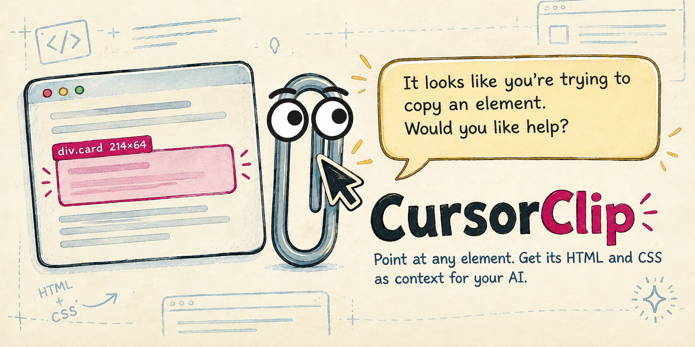
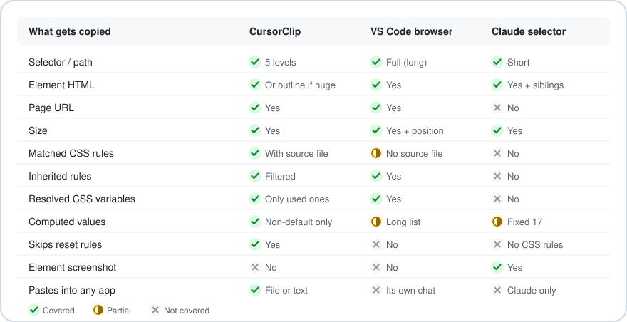
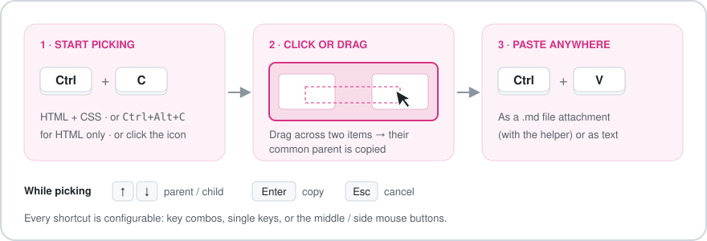
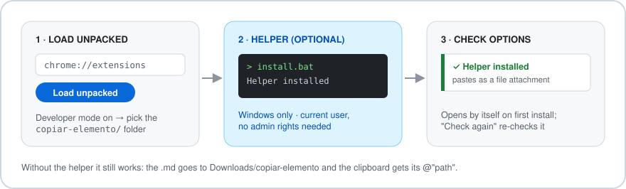
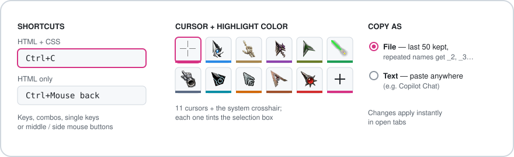
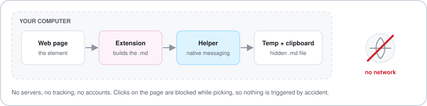

  

**CursorClip** is a Chrome extension that lets you point at any element on a web page and copy what an AI (or a teammate) needs to understand it: its HTML, the CSS that styles it — **with the file each rule comes from** — what it inherits from its parents, the CSS variables it uses and its final computed values. Paste it into Claude, Copilot, DeepSeek or any chat as a `.md` file or as plain text.

> The extension UI and the copied labels are currently in Spanish.

---

## What it copies

Every copy is a small Markdown document:

| Part | Details |
|---|---|
| **Element** | Readable selector (up to 5 levels), rendered size and full page URL. |
| **HTML** | The element's `outerHTML`. If it is huge (over 4,000 characters), you get a **structure outline** instead: tags, ids and classes 5 levels deep, with repeated siblings grouped as `× 20`. |
| **Matched rules** | Every rule that targets the element, grouped by **source stylesheet** (`bootstrap.min.css`, `app.css`…), active `@media` only. |
| **Inherited** | For each inherited property (`color`, `font-*`, `line-height`, `white-space`, `cursor`…), the nearest ancestor rule that sets it. |
| **Variables** | Only the `var(--x)` used by those rules, with their resolved value. |
| **Computed values** | A short list with the defaults left out (`0px`, `none`, `auto`…). Color and font only when the element has its own text. |

Generic reset rules (`canvas, caption, center, … { margin: 0 }`) are skipped: they match everything and say nothing.

## How it compares

Compared with the element pickers in VS Code's integrated browser and in Claude, CursorClip is the only one that tells you **where each rule lives**, it trims the noise (resets and default values), and it works in **any app** you paste into. The one thing it doesn't do (yet) is an element screenshot.

## How to use it

1. **Start picking** with `Ctrl+C` (HTML + CSS), `Ctrl+Alt+C` (HTML only), or a left click on the toolbar icon. The element under the cursor is highlighted and your cursor changes.
2. **Choose the element**:
   - **Click** it, or press `Enter`.
   - **Drag** across several things: the highlight climbs to their **common parent**, and that is what gets copied.
   - `↑` / `↓` move to the parent / first child. `Esc` cancels.
3. **Paste** with `Ctrl+V`. A green toast confirms what was copied.

`Ctrl+C` stays a normal copy whenever you have text selected or you are typing in a field. Clicks never reach the page while you are picking.

## Installation

1. Open `chrome://extensions`, turn on **Developer mode** and click **Load unpacked**.
2. Select the [`copiar-elemento/`](copiar-elemento) folder. The options page opens by itself.
3. *(Optional, Windows)* Run [`install.bat`](copiar-elemento/install.bat) from that folder. It registers the **native helper** for Chrome and Brave, for your user only, without admin rights. Back in the options page, click **Volver a comprobar**.

**With the helper**, each copy is saved as a hidden `.md` in `%TEMP%\copiar-elemento\` and put on the clipboard **as a real file**, so apps like Claude or DeepSeek attach it when you paste.
**Without it**, the `.md` goes to `Downloads\copiar-elemento\` and the clipboard gets `@"<path>"`, which Claude also resolves into the file.

Run [`uninstall.bat`](copiar-elemento/uninstall.bat) to remove the helper. If you move the folder, run `install.bat` again.

## Options

- **Shortcuts:** record anything: combos, single keys (active only outside text fields), or the middle / side mouse buttons. Each shortcut can step aside when text is selected.
- **Cursor:** 11 cursors plus the system crosshair. Each one tints the selection box, so the highlight matches the cursor.
- **Copy as:** a **file** (the last 50 are kept; repeated names become `name_2.md`, `name_3.md`…) or **text** (for chats that don't accept pasted files, like Copilot Chat in VS Code).

Changes apply instantly in open tabs.

## Privacy and permissions

Everything happens on your computer: there is no server, no analytics and no network request. The helper only writes the `.md` file and sets the clipboard.

| Permission | Why |
|---|---|
| Content script on all sites | To pick elements on any page you choose. |
| `activeTab`, `scripting` | So the toolbar icon also works in tabs that were open before installing. |
| `storage` | Your shortcuts and preferences. |
| `downloads`, `downloads.ui` | Saving the `.md` when the helper isn't installed, without a download pop-up. |
| `nativeMessaging` | Talking to the optional helper. |

Stylesheets served from another domain can't be read by any extension (browser security). When that happens the copy says how many were skipped, and the computed values still describe the final look.

## License

Released under the [MIT License](LICENSE).
